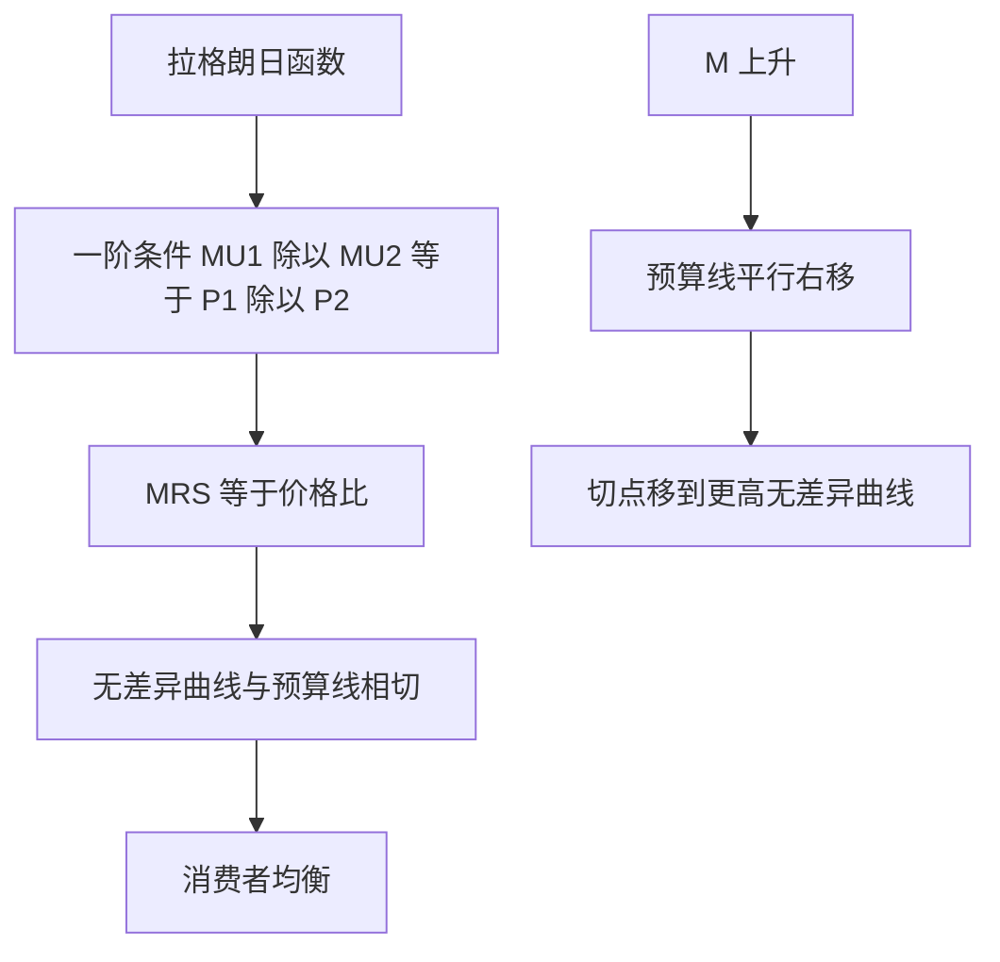

# 06 无差异曲线与消费者均衡是什么？（小白版）

<div style="text-align:right;margin:10px 0;"><a href="../../exam.html" target="_blank" style="display:inline-block;padding:6px 16px;background:#2563eb;color:#fff;border-radius:6px;text-decoration:none;font-size:14px;">📝 开始做题</a></div>


## 一、为什么要学这个？

**你有 50 块，买奶茶和披萨，怎么组合最爽？**

- A：1 杯奶茶 + 2 块披萨；
- B：2 杯奶茶 + 1.5 块披萨；
- C：3 杯奶茶 + 1 块披萨。

哪组最爽？这不是算算术，这是**消费者均衡**在回答的问题。

**不学的后果**：
你会觉得"我凭感觉选就行"——但论文里要写清楚"消费者为什么在收入涨了之后多下馆子少囤米"，光靠感觉说不清。
**无差异曲线**就是把"主观偏好"画成图，让你能算出"价格变了，需求量变多少"。它是整个需求理论的几何核心，也是你后面学 ELES 模型、几乎所有消费实证的理论地基。

---

## 二、是什么？

### 生活比喻：你在山上看等高线

想象你站在一座山的半山腰，手里拿 GPS：

- 往东走 1 公里，海拔还是 500 米；
- 往南走 1 公里，海拔还是 500 米；
- 把所有"海拔 500 米"的点连起来，就是**等高线**。

**无差异曲线**就是：把所有"爽感一样"的奶茶+披萨组合连起来。

- A（1 奶茶+2 披萨）和 B（2 奶茶+1.5 披萨）你觉得一样爽 → 它们在同一条无差异曲线上；
- C（3 奶茶+2 披萨）更爽 → 它落在更高的一条无差异曲线上。

**离原点越远 = 组合越多 = 越爽**，和"等高线越靠上 = 海拔越高"一个道理。

### 严格定义

> **无差异曲线（Indifference Curve, IC）**：给消费者带来**同等满足程度**的两种商品所有组合的轨迹，即 $U(X,Y) = U_0$（常数）。
>
> **边际替代率（Marginal Rate of Substitution, MRS）**：保持效用不变，**多消费一单位 X，愿意放弃多少 Y**。
>
> $$MRS_{xy} = -\frac{\Delta Y}{\Delta X} = \frac{MU_x}{MU_y}$$
>
> （前面加负号是因为 X 增加时 Y 在减少，加负号让 MRS 是正数。）
>
> **预算线（Budget Line）**：收入 I 和价格 $P_x, P_y$ 给定时，全部收入能买到的 X、Y 组合：
>
> $$P_x \cdot X + P_y \cdot Y = I$$
>
> **消费者均衡**：预算线与无差异曲线**相切**的那个点，此时 $MRS_{xy} = P_x / P_y$。

### 无差异曲线的四个性质

1. **向右下倾斜**：多拿一种就得少拿另一种，不然就不是"同等爽"；
2. **凸向原点**（边际替代率递减）：奶茶越多，你愿意用披萨换奶茶的意愿越弱；
3. **离原点越远越爽**：组合越多越好（多多益善假设）；
4. **任意两条不相交**：相交会推出"A 比 B 爽又比 B 不爽"的矛盾。

### 符号表

| 符号 | 怎么读 | 是什么 | 生活类比 |
|------|--------|--------|----------|
| $U(X,Y)$ | "U" | 效用函数 | 爽感打分 |
| $IC$ | "indifference curve" | 无差异曲线 | 爽感等高线 |
| $MRS_{xy}$ | "MRS x y" | 边际替代率 | 多一杯奶茶愿放弃几块披萨 |
| $P_x, P_y$ | "P x, P y" | X、Y 价格 | 奶茶、披萨单价 |
| $I$ | "I" | 货币收入 | 你这个月能花的钱 |
| $MU_x$ | "MU x" | X 的边际效用 | 多一杯奶茶多爽多少 |

---

## 三、公式怎么来的？（手把手推）

### 3.1 为什么 MRS = MU_x / MU_y？

**问题**：多喝一杯奶茶（X 加 1），爽感增加 $MU_x$；为了保持爽感不变，得少吃几块披萨（Y 减 $\Delta Y$），爽感减少 $MU_y \cdot \Delta Y$。

**保持爽感不变**：增加的爽 = 减少的爽，所以净变化为 0：

$$MU_x \cdot \Delta X + MU_y \cdot \Delta Y = 0$$

**移项**：把第二项挪到右边

$$MU_x \cdot \Delta X = -MU_y \cdot \Delta Y$$

**两边除以 $MU_y \cdot \Delta X$**：

$$\frac{MU_x}{MU_y} = -\frac{\Delta Y}{\Delta X}$$

右边 $-\Delta Y/\Delta X$ 就是 MRS（因为 $\Delta Y$ 本身是负的，加个负号变正）。

**结论**：

$$MRS_{xy} = \frac{MU_x}{MU_y}$$

**读一遍**：你愿意用多少 Y 换一个 X，取决于 X 和 Y 各自边际效用之比。奶茶越爽（$MU_x$ 大），你越愿意拿披萨换它。

### 3.2 消费者均衡条件怎么推出来？

**预算线斜率**：把 $P_x X + P_y Y = I$ 改写成 $Y = I/P_y - (P_x/P_y) X$。

这是一条直线 $Y = a + bX$，斜率 $b = -P_x/P_y$。

**无差异曲线斜率**：对 $U(X,Y) = U_0$ 求全微分

$$\frac{\partial U}{\partial X} dX + \frac{\partial U}{\partial Y} dY = 0$$

即 $MU_x dX + MU_y dY = 0$，所以 $dY/dX = -MU_x/MU_y = -MRS_{xy}$。

**相切 = 两线斜率相等**：

$$-MRS_{xy} = -\frac{P_x}{P_y} \;\;\Rightarrow\;\; MRS_{xy} = \frac{P_x}{P_y}$$

**代入 MRS 表达式**：

$$\frac{MU_x}{MU_y} = \frac{P_x}{P_y}$$

**交叉相乘整理**：

$$\frac{MU_x}{P_x} = \frac{MU_y}{P_y}$$

**看！这就是上一篇的"等边际原则"！**——基数效用论（直接比 MU/P）和序数效用论（画图相切）殊途同归，结论一模一样。这不是巧合，是同一枚硬币的两面。

### 3.3 柯布-道格拉斯效用函数的特殊结论

设 $U = X^\alpha Y^{1-\alpha}$，$0 < \alpha < 1$。

- $MU_x = \alpha X^{\alpha-1} Y^{1-\alpha} = \alpha U / X$
- $MU_y = (1-\alpha) X^\alpha Y^{-\alpha} = (1-\alpha) U / Y$

代入均衡条件 $MU_x/MU_y = P_x/P_y$：

$$\frac{\alpha U / X}{(1-\alpha) U / Y} = \frac{\alpha Y}{(1-\alpha) X} = \frac{P_x}{P_y}$$

解得 $Y/X = \frac{(1-\alpha)P_x}{\alpha P_y}$，即：

$$P_x X = \alpha I, \qquad P_y Y = (1-\alpha) I$$

**惊人结论**：不管价格怎么变（只要还是 C-D 函数），消费者永远把收入的 $\alpha$ 比例花在 X 上、$(1-\alpha)$ 花在 Y 上。这是 C-D 效用函数最方便也最"死板"的性质——后面 ELES 模型就是给它加了一个"最低必需支出"改造出来的。

---

## 四、一个完整的数字例子（Python 验证）

**题目**：小王收入 $I = 100$ 元，奶茶 $P_x = 10$ 元/杯，披萨 $P_y = 20$ 元/块。效用函数 $U = X \cdot Y$（即 $\alpha = 0.5$ 的 C-D）。问最优消费组合 $(X^*, Y^*)$。

**手算**：

**第一步**：预算线 $10X + 20Y = 100$，化简 $X + 2Y = 10$。

**第二步**：均衡条件 $MU_x/MU_y = P_x/P_y$。

- $MU_x = \partial U/\partial X = Y$（对 X 求偏导，把 Y 当常数）；
- $MU_y = \partial U/\partial Y = X$；
- $MU_x/MU_y = Y/X$。

**第三步**：令 $Y/X = P_x/P_y = 10/20 = 0.5$，即 $Y = 0.5X$。

**第四步**：代入预算线 $X + 2(0.5X) = 10$，得 $2X = 10$，$X^* = 5$。

**第五步**：$Y^* = 0.5 \times 5 = 2.5$。

**结论**：最优组合 = **5 杯奶茶 + 2.5 块披萨**。

**验证**：
- 花费 $= 5\times 10 + 2.5\times 20 = 50 + 50 = 100$ ✅
- 效用 $= 5 \times 2.5 = 12.5$
- 检查是否均衡：$MU_x/P_x = Y/10 = 2.5/10 = 0.25$；$MU_y/P_y = X/20 = 5/20 = 0.25$ ✅ 两边相等。

**Python 验证 + 画图**：

```python
import matplotlib.pyplot as plt
import numpy as np
plt.rcParams['font.sans-serif'] = ['PingFang SC']
plt.rcParams['axes.unicode_minus'] = False

# 预算线: 10X + 20Y = 100  => Y = 5 - 0.5X
X = np.arange(0.5, 10, 0.1)
Y_budget = 5 - 0.5 * X

# 无差异曲线: U = X*Y = 12.5  => Y = 12.5/X
Y_ic1 = 12.5 / X      # 过最优点的那条
Y_ic2 = 8.0 / X       # 一条更差的
Y_ic3 = 18.0 / X      # 一条更好但够不着的

plt.figure(figsize=(8, 6))
plt.plot(X, Y_budget, label='预算线 10X+20Y=100', linewidth=2)
plt.plot(X, Y_ic2, '--', label='U=8（够得着但不爽）', color='gray')
plt.plot(X, Y_ic1, label='U=12.5（相切·最优）', color='red', linewidth=2)
plt.plot(X, Y_ic3, '--', label='U=18（更爽但超预算）', color='green')
plt.scatter([5], [2.5], color='black', s=80, zorder=5, label='最优点 (5, 2.5)')
plt.xlabel('奶茶 X（杯）')
plt.ylabel('披萨 Y（块）')
plt.xlim(0, 10)
plt.ylim(0, 8)
plt.title('消费者均衡：预算线与无差异曲线相切')
plt.legend(loc='upper right')
plt.grid(alpha=0.3)
plt.savefig('consumer_equilibrium.png', dpi=150, bbox_inches='tight')
```

**读图三件事**：
1. 灰色虚线 U=8 整条在预算线内——够得着，但不爽；
2. 红色实线 U=12.5 刚好和预算线相切在 (5, 2.5)——这是你能摸到的最爽的一条；
3. 绿色虚线 U=18 整体在预算线上方——更爽，但钱不够。

---

## 五、什么时候能用？（前提条件）

1. **消费者能给偏好排序**：A 和 B 哪个好能比出来（不需要绝对打分，序数效用论）；
2. **偏好稳定且传递**：觉得 A>B、B>C，就一定 A>C；
3. **边际替代率递减**：无差异曲线凸向原点（多多益善 + 喜欢多样化）；
4. **消费者是价格接受者**：单个买家影响不了价格；
5. **收入和价格给定**：当期一次性决策，没有储蓄/借贷。

---

## 六、什么时候不能用？（易错点）

1. **完全替代品**（1 元和 2 元硬币）：无差异曲线是直线，MRS 恒定，最优解是角点（全买便宜的），没有内点相切。
2. **完全互补品**（左脚鞋+右脚鞋）：无差异曲线是 L 形，最优解永远在拐角（必须 1:1 搭配）。
3. **上瘾品/炫耀品**：喝得越多越想喝，MRS 递增，无差异曲线凹向原点——模型不适用。
4. **离散商品**（你只能买整数杯奶茶）：无差异曲线是散点，不是连续曲线，要改用离散选择模型（后面 Logit 那章讲）。
5. **跨期决策**（今天喝还是明天喝）：要引入贴现率，不是静态均衡能处理的。

---

## 七、容易和什么搞混？

| 概念 | 一句话 | 数学表达 |
|------|--------|----------|
| **无差异曲线** | 爽感相同的组合 | $U(X,Y) = U_0$ |
| **预算线** | 钱能买的组合 | $P_x X + P_y Y = I$ |
| **MRS** | 无差异曲线斜率的绝对值 | $MU_x/MU_y$ |
| **预算线斜率** | $-P_x/P_y$ | 价格比 |
| **消费者均衡** | 两线相切 | $MRS = P_x/P_y$ |
| **收入消费曲线** | 收入变了，切点连起来 | —— |
| **恩格尔曲线** | 收入和 X 需求量的关系 | $X = f(I)$ |

---

## 八、在论文里怎么用？

### 8.1 线性支出系统（ELES）——最经典的应用

ELES（Extended Linear Expenditure System）就是把 C-D 效用函数改成 Stone-Geary 形式：

$$U = \prod_{i=1}^{n} (Q_i - \gamma_i)^{\beta_i}$$

其中 $\gamma_i$ 是对第 $i$ 种商品的**最低必需支出**（比如米饭再穷也得吃 200 块）。推导出来的需求函数：

$$P_i Q_i = P_i \gamma_i + \beta_i \left( I - \sum_j P_j \gamma_j \right)$$

**论文例子**：《中国农村居民消费结构变化——基于 ELES 模型的实证分析》
- 数据：CHFS / 国家统计局住户调查；
- 被解释变量：各类消费支出（食品、衣着、居住、文教）；
- 解释变量：可支配收入；
- 用 OLS 估计每类商品的基本消费 $\gamma_i$ 和边际预算份额 $\beta_i$；
- 算出来食品的 $\beta_i$ 逐年下降 → 验证恩格尔定律；
- 统计方法链接：[[../03_相关与回归/05_多元线性回归|多元线性回归]]（ELES 本质是一组联立的线性回归）、[[../03_相关与回归/09_虚拟变量|虚拟变量]]（分城乡、分东中西部）。

### 8.2 替代效应与收入效应的分解

**题目例**：《猪肉价格上涨对重庆居民肉类消费的冲击——基于 Hicks 分解》
- 猪肉涨价 → 预算线绕轴旋转；
- 总效应 = 替代效应（换鸡肉）+ 收入效应（实际购买力下降）；
- 用 Slutsky 方程 $dQ_x/dP_x = \partial h_x/\partial P_x - Q_x \cdot \partial Q_x/\partial I$；
- 实证上用价格弹性和收入弹性的回归系数算。

### 8.3 政策福利比较

**题目例**：《发现金 vs 发消费券的福利效应——基于无差异曲线的模拟》
- 发钱：预算线整体外移；
- 发定向消费券：预算线在某方向多一截（被"掰弯"）；
- 画图比较两种政策下能达到的最高无差异曲线——**现金补贴一般不劣于实物补贴**，因为消费者有选择自由；
- 这是评估"重庆家电下乡""汽车以旧换新"等政策的理论工具。

**本科生常见踩坑**：
- 把无差异曲线画成凹的（凸向原点才对）；
- 只说"相切最优"不写 $MRS = P_x/P_y$ 的条件；
- 直接用 C-D 效用函数估计消费结构——它意味着"各类支出占比恒定"，现实中食品占比随收入下降，必须用 ELES/AIDS 模型；
- 忽略偏好异质性：千人千面，用平均效用函数会把偏好差异抹平。

---

## 九、现实意义

- **为什么工资涨了人们少逛街多下馆子？** 收入扩张线随收入变化，正常品消费占比上升。
- **为什么苹果手机贵还卖爆？** 果粉的无差异曲线极度偏向苹果（对苹果的 MRS 极高），哪怕贵一倍也愿意换。
- **为什么商场发购物卡比发现金差？** 购物卡把你锁在那家店，预算线被掰弯，效用不如现金——这就是企业福利"货币化"的理论依据。
- **为什么双十一忍不住剁手？** 降价瞬间预算线外移，加上"限时"制造的跨期错觉，你觉得"现在不买亏"。
- **为什么重庆小面从 6 块涨到 12 块，你还是天天吃？** 小面对你是必需品，MRS 高，替代效应小——你最多偶尔换个抄手。

---

## 十、速记卡

> **无差异曲线 = 爽感等高线**，凸向原点。
> **预算线 = 钱能买的组合**，斜率 = $-P_x/P_y$。
> **消费者均衡 = 两线相切**：$MRS = P_x/P_y$，即 $MU_x/P_x = MU_y/P_y$。
> **MRS = MU_x/MU_y**：多一杯奶茶愿放弃几块披萨，由两边边际效用决定。
> 离原点越远越爽，但够不着（超预算）。
> C-D 效用函数的"死板"性质：永远按固定比例花收入。

---

⬅️ 上一篇：[[05_效用与边际效用递减是什么|05 效用与边际效用递减]] ｜ 📑 [[00_章节总结|目录]] ｜ 下一篇：[[07_生产函数与边际报酬递减是什么|07 生产函数与边际报酬递减]] ➡️

---

## 附：理论推导与数学推导（深度补充）

### 一、理论推导（消费者均衡条件）

**两个工具**：
- 预算线：$P_1 X_1 + P_2 X_2 = M$。斜率 $-P_1/P_2$。
- 无差异曲线：$U(X_1, X_2) = \bar{U}$。斜率为边际替代率 $MRS = -dX_2/dX_1 = MU_1/MU_2$。

**推导过程**：
- 第一步：消费者在预算约束下最大化 U：$\max U(X_1, X_2)$ s.t. $P_1 X_1 + P_2 X_2 = M$。
- 第二步：构造拉格朗日函数 $L = U(X_1, X_2) + \lambda(M - P_1 X_1 - P_2 X_2)$。
- 第三步：一阶条件 $\partial L/\partial X_1 = MU_1 - \lambda P_1 = 0$，$\partial L/\partial X_2 = MU_2 - \lambda P_2 = 0$。
- 第四步：两式相除：$\frac{MU_1}{MU_2} = \frac{P_1}{P_2}$，即 $MRS = P_1/P_2$。
- 结论：无差异曲线与预算线相切时效用最大，切点即消费者均衡。

### 二、数学推导（Cobb-Douglas 最优解）

$U = X_1^\alpha X_2^{1-\alpha}$。
$MU_1 = \alpha X_1^{\alpha-1} X_2^{1-\alpha} = \alpha U / X_1$。
$MU_2 = (1-\alpha) X_1^\alpha X_2^{-\alpha} = (1-\alpha) U / X_2$。

均衡条件 $MU_1/MU_2 = P_1/P_2$：
$$\frac{\alpha U / X_1}{(1-\alpha) U / X_2} = \frac{P_1}{P_2}$$
$$\frac{\alpha X_2}{(1-\alpha) X_1} = \frac{P_1}{P_2}$$
$$X_2 = \frac{1-\alpha}{\alpha}\cdot\frac{P_1}{P_2} X_1$$

代入预算线 $P_1 X_1 + P_2 X_2 = M$：
$$P_1 X_1 + P_2 \cdot \frac{1-\alpha}{\alpha}\cdot\frac{P_1}{P_2} X_1 = M$$
$$P_1 X_1 \left(1 + \frac{1-\alpha}{\alpha}\right) = M$$
$$P_1 X_1 \cdot \frac{1}{\alpha} = M$$
$$X_1^* = \frac{\alpha M}{P_1}, \quad X_2^* = \frac{(1-\alpha) M}{P_2}$$

—— 消费者把 α 比例的收入花在商品 1 上，(1-α) 花在商品 2 上。

### 三、预算线移动怎么影响最优选择

- M 上升：预算线平行右移，新切点在更高无差异曲线上（收入效应）。
- P₁ 下降：预算线绕纵轴向外旋转，新切点 X₁ 增加（替代效应+收入效应）。

**mermaid 因果图**：


### 四、生活实例

**你吃奶茶和炸鸡**：奶茶 P₁=10 元，炸鸡 P₂=20 元，M=100 元，α=0.4（40% 收入买奶茶）。最优：X₁*=4 杯奶茶，X₂*=3 块炸鸡。如果奶茶降到 5 元，X₁*=8 杯——这就是价格下降替代效应。

---

## 📖 配套教材笔记
- [[../../教材笔记/06_西方经济学/02_消费者选择/知识点/KP03_无差异曲线|原KP·无差异曲线]]
- [[../../教材笔记/06_西方经济学/02_消费者选择/知识点/KP04_预算线|原KP·预算线]]
- [[../../教材笔记/06_西方经济学/02_消费者选择/知识点/KP05_序数效用论与消费者均衡|原KP·序数效用论与消费者均衡]]
- [[../../教材笔记/06_西方经济学/02_消费者选择/知识点/KP06_替代效应与收入效应|原KP·替代效应与收入效应]]
- [[../../教材笔记/06_西方经济学/02_消费者选择/00_章节总结|原书·第2章总结]]
