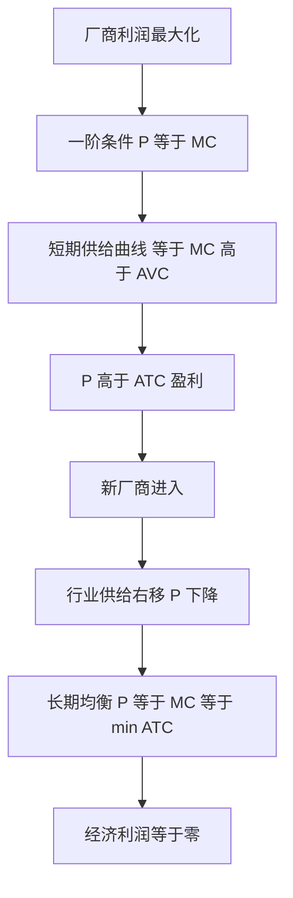

# 09 完全竞争市场是什么？（小白版）

<div style="text-align:right;margin:10px 0;"><a href="../../exam.html" target="_blank" style="display:inline-block;padding:6px 16px;background:#2563eb;color:#fff;border-radius:6px;text-decoration:none;font-size:14px;">📝 开始做题</a></div>


## 一、为什么要学这个？

**菜市场里的白菜摊，凭什么定不了价？**

- 全菜市场 100 个摊都在卖白菜；
- 你卖 2 块一斤，隔壁摊卖 1.9 块，顾客全跑隔壁；
- 你降到 1.8 块，隔壁也跟着降；
- 最后大家只能按市场均衡价 1.9 块卖。

**单个卖家在市场面前就是"价格接受者"**——这就是完全竞争市场。

**不学会怎样？**
你写论文研究"农产品价格形成机制""粮食保护价"，连完全竞争市场的四个条件都列不出来。
**完全竞争是理想基准**——现实世界离它越远，市场失灵越严重，政府越有理由介入。

---

## 二、是什么？

### 生活比喻：一群人抢同一个顾客

想象你是 100 个奶茶店之一，顾客随便挑：
- 你涨价 1 块 → 顾客瞬间跑光（需求弹性 ∞）；
- 你降价 1 块 → 顾客瞬间涌来，但你产能跟不上；
- 所以你只能按市场价卖，**你面对的需求曲线是一条水平线**。

### 严格定义

> **完全竞争市场（Perfect Competition）的四个条件**：
> 1. **大量买者和卖者**：每个人占市场份额极小，都是价格接受者；
> 2. **产品同质**：所有卖家的商品一模一样，顾客不挑牌子；
> 3. **完全信息**：所有人都知道价格、质量、技术；
> 4. **自由进入退出**：没壁垒，赚钱了大家涌进来，亏钱了大家退出去。
>
> **厂商需求曲线**：一条水平线（价格由市场定，厂商接受）。
>
> **收益**：
> - 总收益 $TR = P \cdot Q$；
> - 平均收益 $AR = TR/Q = P$；
> - 边际收益 $MR = \Delta TR/\Delta Q = P$。
>
> **利润最大化条件**：$MR = MC$，即 $P = MC$。

### 完全竞争 vs 其他市场

| 市场结构 | 卖家数 | 产品差异 | 定价权 | 例子 |
|----------|--------|----------|--------|------|
| **完全竞争** | 极多 | 同质 | 无 | 农产品、菜市场 |
| **垄断竞争** | 较多 | 有差异 | 微弱 | 奶茶店、餐馆 |
| **寡头** | 几家 | 同质/差异 | 较强 | 石油、电信、航空 |
| **完全垄断** | 一家 | 独特 | 完全 | 自来水、电网 |

### 符号表

| 符号 | 怎么读 | 是什么 | 生活类比 |
|------|--------|--------|----------|
| $P$ | "P" | 市场价格 | 白菜 1.9 块一斤 |
| $MR$ | "marginal revenue" | 边际收益 | 多卖一杯多赚多少 |
| $MC$ | "marginal cost" | 边际成本 | 多做一杯多花多少 |
| $AR$ | "average revenue" | 平均收益 | 每杯平均赚多少 |

---

## 三、公式怎么来的？（手把手推）

### 3.1 为什么 MR = P？

**问题**：完全竞争厂商多卖一杯奶茶，多赚多少钱？

**第一步**：市场价格 P 是给定的（你一个小卖家左右不了）。
**第二步**：多卖一杯，收入 = P × (Q+1) - P × Q = P。
**第三步**：所以 $\Delta TR/\Delta Q = P$，即 MR = P。

**这一步和垄断厂商对比**：
- 垄断厂商多卖一件必须降价（因为它面对整个市场需求曲线），所以 MR < P；
- 完全竞争厂商多卖一件不影响价格（它面对水平需求曲线），所以 MR = P。

### 3.2 利润最大化条件：P = MC

**直觉**：
- 如果 P > MC：多做一杯赚得比花得多，继续做；
- 如果 P < MC：多做一杯亏，停；
- P = MC 时，最后一杯赚的 = 花的，利润最大。

**数学**：利润 $\pi = TR - TC = P \cdot Q - TC(Q)$。
对 Q 求导：
$$\frac{d\pi}{dQ} = P - MC = 0$$
所以 $P = MC$。

**这一步怎么读**：让利润最大化的产量，就是 P 和 MC 曲线的交点。

### 3.3 短期均衡的三种情况

- **P > min(ATC)**：赚超额利润；
- **P = min(ATC)**：经济利润为 0（正常利润）；
- **min(AVC) < P < min(ATC)**：亏但继续做（能补点 FC）；
- **P < min(AVC)**：停止营业。

### 3.4 长期均衡

**自由进入退出**：
- 短期有利润 → 新厂商涌入 → 供给右移 → 价格跌；
- 短期亏损 → 厂商退出 → 供给左移 → 价格涨；
- 最后达到长期均衡：$P = min(ATC) = MC$，经济利润为 0。

**这一步为什么经济利润为 0？**
因为只要还有正利润，就有人进来抢生意，直到利润被摊薄到 0。这就是"看不见的手"。

---

## 四、一个完整的数字例子（Python 验证）

**题目**：完全竞争奶茶店成本函数 $TC = 300 + Q^2$，市场价格 P = 40。

问：
(1) 利润最大化产量？
(2) 利润多少？
(3) 长期会不会有人进来？

**手算**：

(1) 令 P = MC：
- MC = dTC/dQ = 2Q；
- 40 = 2Q；
- Q* = 20。

(2) 利润：
- TR = 40 × 20 = 800；
- TC = 300 + 400 = 700；
- π = 100 元（正利润）。

(3) 长期：
- min(ATC)：ATC = 300/Q + Q，求导 -300/Q² + 1 = 0，Q = √300 ≈ 17.3，ATC_min ≈ 34.6；
- 当前 P = 40 > 34.6 → 有正利润 → 新厂商涌入；
- 供给右移 → 价格跌到 34.6 → 每个厂商产量 17.3 → 经济利润 0。

**Python 验证**：

```python
import numpy as np
import matplotlib.pyplot as plt
plt.rcParams['font.sans-serif'] = ['PingFang SC']
plt.rcParams['axes.unicode_minus'] = False

Q = np.arange(1, 40, 0.1)
TC = 300 + Q**2
ATC = TC / Q
MC = 2*Q
AVC = Q

plt.figure(figsize=(9, 6))
plt.plot(Q, ATC, label='ATC', linewidth=2)
plt.plot(Q, MC, label='MC', linewidth=2, linestyle='--')
plt.plot(Q, AVC, label='AVC', linewidth=1)
plt.axhline(40, color='red', linestyle=':', label='P=40（短期）')
plt.axhline(34.6, color='green', linestyle=':', label='P=34.6（长期均衡）')
plt.scatter([20], [40], color='red', s=100, zorder=5, label='短期均衡 Q=20')
plt.scatter([17.3], [34.6], color='green', s=100, zorder=5, label='长期均衡 Q=17.3')
plt.xlabel('产量 Q')
plt.ylabel('价格/成本')
plt.title('完全竞争厂商短期与长期均衡')
plt.legend()
plt.grid(alpha=0.3)
plt.ylim(0, 60)
plt.savefig('perfect_competition.png', dpi=150, bbox_inches='tight')
plt.show()
```

---

## 五、什么时候能用？（前提条件）

1. **四个条件全满足**：大量买家卖家、产品同质、完全信息、自由进入；
2. **厂商是价格接受者**：单个厂商的产量变化不影响市场价格；
3. **短期 vs 长期要分清**。

---

## 六、什么时候不能用？（易错点）

1. **现实中完全竞争几乎不存在**：农产品最接近，但大型商超、品牌包装已经让它偏离。
2. **不要把"竞争激烈"等同于"完全竞争"**：奶茶店竞争激烈但产品有差异，是垄断竞争。
3. **完全信息假设太强**：现实中消费者不知道每家店的成本。
4. **自由进入有壁垒**：专利、牌照、资本规模都可能挡人。

---

## 七、容易和什么搞混？

| 概念 | 一句话 |
|------|--------|
| **完全竞争** | 无数小卖家，产品同质，谁都定不了价 |
| **垄断竞争** | 卖家多但产品有差异（奶茶店） |
| **完全垄断** | 一家独大，自己定价格 |
| **价格接受者** | 单个厂商面对水平需求曲线 |
| **价格制定者** | 垄断厂商面对向下倾斜的需求曲线 |

---

## 八、在论文里怎么用？

### 8.1 农产品市场研究

**题目例**：《中国小麦市场的完全竞争性测度》
- 用赫芬达尔指数（HHI）：市场上每个卖家份额的平方和；
- HHI 越小越接近完全竞争；
- 中国小麦市场 HHI 通常 < 0.1 → 接近完全竞争。

### 8.2 粮食保护价政策

**题目例**：《粮食最低收购价政策的效果评估》
- 完全竞争下市场均衡价已经很低（需求弹性小，丰收价跌）；
- 保护价设在均衡价上方 → 供给 > 需求 → 国家托市收购；
- 用 DID 评估政策对农民收入的影响。

### 8.3 市场势力测度

**题目例**：《中国制造业市场势力测度——基于勒纳指数》
- 勒纳指数 $L = (P - MC)/P$；
- 完全竞争下 L = 0；
- L 越大，市场势力越强；
- 用生产函数法估计 MC（Hall 1988 方法）。

### 8.4 进入退出研究

**题目例**：《中国制造业企业进入退出的决定因素》
- 完全竞争模型预测：有利润就进入，亏损就退出；
- 但现实中很多亏损企业不退（僵尸企业）——偏离了完全竞争模型。

**本科生常见踩坑**：
- 把"完全竞争"当现实描述——它只是理论基准；
- 短期和长期均衡混了——短期有利润，长期利润为 0；
- 没说清楚"价格接受者"的含义——不是厂商不想涨价，是涨价就卖不出去。


**📊 对应统计方法**：

- [[../09_时间序列/09_基期报告期与指数方法选择|指数方法]] —— 完全竞争厂商是"价格接受者"，靠 PPI/CPI 等价格指数观察单个厂商能否影响市价。
- [[../02_描述统计/06_总量与相对指标|总量相对指标]] —— 行业集中度 CRn、赫芬达尔指数等相对指标，用来判断市场离完全竞争有多远。

---

## 九、现实意义

- **为什么白菜价格全国差不多？** 无数小农户、产品同质、自由进入 → 完全竞争。
- **为什么农民越丰收越穷？** 完全竞争 + 粮食需求弹性小 → 丰收价跌总收入降。
- **为什么 2015 年猪肉价格暴涨？** 环保政策关闭小猪场（自由进入受限）→ 偏离完全竞争 → 价格上升。
- **为什么电商平台能压农户价？** 一旦渠道集中（拼多多、抖音），买方形成垄断买方势力，不再是完全竞争。

---

## 十、速记卡

> **完全竞争四条件**：人多、同质、信息全、随便进。
> **厂商面对水平需求曲线**：MR = AR = P。
> **利润最大化**：P = MC。
> **短期**：可能赚、可能亏；**长期**：自由进入退出，经济利润 = 0。
> **完全竞争是理想基准**，现实中越偏离越有市场势力。

---

⬅️ 上一篇：[[08_成本曲线是什么|08 成本曲线]] ｜ 📑 [[00_章节总结|目录]] ｜ 下一篇：[[10_完全垄断与价格歧视是什么|10 完全垄断与价格歧视]] ➡️

---

## 附：理论推导与数学推导（深度补充）

### 一、理论推导（完全竞争厂商短期均衡）

**四个假设**：
1. 无数买者卖者，每个都是价格接受者（P 外生）。
2. 产品同质。
3. 自由进入退出。
4. 信息完全。

**厂商决策**：最大化利润 $\pi = TR - TC = P \cdot Q - TC(Q)$。
一阶条件 $\frac{d\pi}{dQ} = 0$：
$$P - \frac{dTC}{dQ} = 0 \quad \Rightarrow \quad P = MC(Q^*)$$

—— 厂商利润最大化产量在 P=MC 处。

**短期停产条件**：
- 若 P > ATC：盈利，继续生产。
- 若 AVC < P < ATC：亏损但继续生产（弥补部分固定成本）。
- 若 P < AVC：停产（生产比停产更亏）。
—— 所以**短期供给曲线是 MC 曲线在 AVC 最低点以上的部分**。

### 二、数学推导（长期均衡）

**长期**：厂商可自由进入退出，经济利润为 0。
- 行业需求右移 → 短期 P 上升 → 现有厂商盈利。
- 盈利吸引新厂商进入 → 行业供给右移 → P 回落。
- 直到 P = min(ATC)，经济利润=0，停止进入。
- 此时 P = MC = min(ATC)。

**Cobb-Douglas 例子**：$TC = cQ^3 - bQ^2 + aQ + FC$。
- $MC = 3cQ^2 - 2bQ + a$。
- $ATC = cQ^2 - bQ + a + FC/Q$。
- 长期均衡 $P^* = MC = ATC_{min}$。
- 解 $MC = ATC$：$3cQ^2 - 2bQ + a = cQ^2 - bQ + a + FC/Q$，得长期均衡产量 $Q^*$。

**mermaid 因果图**：


### 三、生活实例

**你家楼下那条街的奶茶店**：奶茶卖 15 元，MC=8 元，每杯赚 7 元。看到你赚钱，隔壁又开一家。供给多了，价格降到 10 元，你只赚 2 元。再开一家，价格降到 8 元（=MC=min ATC），没人再开了——长期均衡。

---

## 📖 配套教材笔记
- [[../../教材笔记/06_西方经济学/04_完全竞争市场/知识点/KP01_完全竞争市场的特征|原KP·完全竞争市场特征]]
- [[../../教材笔记/06_西方经济学/04_完全竞争市场/知识点/KP02_完全竞争厂商的需求与收益|原KP·完全竞争厂商需求与收益]]
- [[../../教材笔记/06_西方经济学/04_完全竞争市场/知识点/KP03_短期均衡与停止营业点|原KP·短期均衡与停止营业点]]
- [[../../教材笔记/06_西方经济学/04_完全竞争市场/知识点/KP04_长期均衡与供给曲线|原KP·长期均衡与供给曲线]]
- [[../../教材笔记/06_西方经济学/04_完全竞争市场/00_章节总结|原书·第4章总结]]
