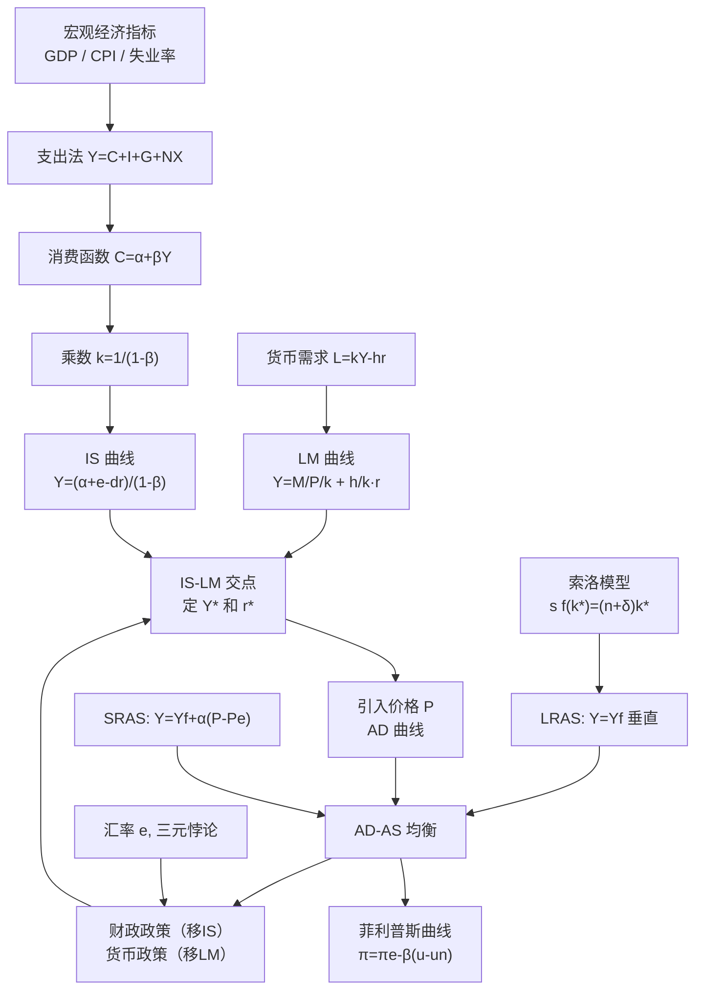

# 14 宏观经济学基础 · 章节总结

> 这一页是考前复习和答辩准备用的。先看公式大表，再看概念关系图，最后做自测题。

---

## 一、一句话总览

学完这一章，你能看懂：为什么央行降息、为什么政府发消费券、为什么 GDP 和失业率绑在一起、为什么 1970 年代会滞胀、为什么中国货币乘数比美国小。

---

## 二、核心概念清单

| 序号 | 概念 | 一句话 | 对应原 KP |
|---|---|---|---|
| 01 | GDP 与国民收入核算 | $Y=C+I+G+NX$，地盘上一年新生产的 | 09章/KP01、KP02 |
| 02 | CPI 与通货膨胀 | 一篮子年货贵了多少，$\pi=\Delta CPI/CPI$ | 09章/KP03 + 13章/KP02 |
| 03 | 失业与奥肯定律 | 失业率超自然率 1%，GDP 缺口约 -2% | 09章/KP04、KP05 + 13章/KP01 |
| 04 | 消费函数与储蓄函数 | $C=\alpha+\beta Y$，β 是 MPC | 10章/KP02 |
| 05 | 乘数效应 | $k=1/(1-MPC)$，1 块变 k 块 GDP | 10章/KP04-KP06 |
| 06 | IS 曲线 | 产品市场均衡 (Y,r)，右下倾斜 | 11章/KP01 |
| 07 | LM 曲线与货币需求 | 货币市场均衡 (Y,r)，右上倾斜 | 11章/KP02、KP03 |
| 08 | IS-LM 均衡与挤出效应 | 两线交点定 (Y*,r*)，政府花钱挤私人投资 | 11章/KP04、KP05 |
| 09 | AD-AS 模型 | 放开价格，P 和 Y 一起决定 | 12章全部 |
| 10 | 菲利普斯曲线 | 短期通胀失业跷跷板，长期垂直 | 13章/KP03 |
| 11 | 财政政策与货币政策 | 花钱收税 vs 印钱调利率 | 15章/KP01-KP03 |
| 12 | 索洛模型与经济增长 | 稳态 $s f(k^*)=(n+\delta)k^*$，长期靠技术 | 16章/KP01-KP03 |
| 13 | 汇率与开放经济 | 三元悖论：固定汇率、独立货币、资本流动最多要俩 | 14章/KP01、KP04 |

---

## 三、核心公式大表

| 公式 | 是什么 | 一句话 |
|---|---|---|
| $Y = C + I + G + NX$ | 支出法 GDP | 四块钱谁花的 |
| $CPI_t = \frac{\sum p_t q_0}{\sum p_0 q_0} \times 100$ | 消费价格指数 | 篮子费用比 |
| $u = \frac{U}{L}$ | 失业率 | 分母是劳动力不是总人口 |
| $C = \alpha + \beta Y$ | 消费函数 | β 是 MPC |
| $k = \frac{1}{1-MPC}$ | 投资乘数 | 1 块变 k 块 |
| $k_G = \frac{1}{1-\beta}$ | 政府购买乘数 | 最大 |
| $k_T = \frac{-\beta}{1-\beta}$ | 税收乘数 | 绝对值小一点 |
| $Y = \frac{\alpha+e-dr}{1-\beta}$ | IS 曲线 | r 前面是负号 |
| $L = kY - hr$ | 货币需求 | 交易预防看 Y，投机看 r |
| $Y = \frac{M/P}{k} + \frac{h}{k}r$ | LM 曲线 | r 前面是正号 |
| $Y = Y_f + \alpha(P-P^e)$ | 短期 AS | 物价超预期涨，企业多产 |
| $\pi = \pi^e - \beta(u-u_n)$ | 短期菲利普斯 | 通胀 = 预期 − β×失业缺口 |
| $m = \frac{1+c}{c+r_r}$ | 货币乘数 | 降准提乘数 |
| $\frac{\Delta Y}{Y} = \alpha\frac{\Delta K}{K} + (1-\alpha)\frac{\Delta L}{L} + \frac{\Delta A}{A}$ | 增长核算 | 残差 = TFP |
| $s f(k^*) = (n+\delta)k^*$ | 索洛稳态 | 投资 = 持平投资 |
| $\varepsilon = e \frac{P}{P_f}$ | 实际汇率 | 剔除物价的真实汇率 |

---

## 四、概念关系图

---

## 五、十大易错点

1. **GDP 按地盘算（GDP）不是按国籍算（GNP/GNI）**；股票不算投资，二手车二手房不算当年 GDP。
2. **失业率分母是劳动力不是总人口**；失业率下降不一定是好事（可能是沮丧工人退出）。
3. **APC 可以大于 1**（低收入刷信用卡）；MPC 是斜率，APC 是射线斜率。
4. **乘数 $1/(1-MPC)$ 是封闭经济、无挤出、有闲置产能的极端结果**，现实要打折。
5. **IS 右下倾斜，LM 右上倾斜**；利率变是沿曲线移动，自发支出变是整条移动。
6. **流动性陷阱 = LM 水平 = 货币政策失效**；古典区域 = LM 垂直 = 财政政策失效。
7. **挤出效应**：政府花钱推高利率，挤掉私人投资；衰退时挤出小，过热时挤出大。
8. **短期 AS 右上倾斜，长期 AS 垂直**；扩张需求短期增产，长期只涨价（货币中性）。
9. **短期菲利普斯右下倾斜（通胀失业替代），长期垂直（无替代）**——不能靠印钱永远保就业。
10. **索洛模型长期人均增长只靠技术进步**；储蓄率高只有水平效应，没有增长效应。

---

## 六、论文里怎么用这一章？

| 你写的论文题目 | 用到本章哪些概念 |
|---|---|
| 财政支出对经济增长的影响 | GDP 当被解释变量、乘数效应、挤出效应 |
| 货币政策效果 | CPI、利率、IS-LM、货币乘数、流动性陷阱 |
| 通货膨胀成因分解 | CPI、AD-AS、菲利普斯、需求拉上 vs 成本推动 |
| 失业率/就业问题 | 失业率口径、奥肯定律、自然失业率 |
| 经济增长/TFP 测算 | 索洛模型、增长核算、潜在产出、LRAS |
| 汇率与出口 | 实际汇率、三元悖论、净出口 |
| 房地产/消费 | 消费函数 MPC、财富效应、利率传导 |

**本科论文最常见的变量设计**：

- 被解释变量：实际 GDP 增速（取对数差分）、CPI 同比、城镇调查失业率；
- 核心解释变量：财政支出增速、M2 增速、贷款利率、实际有效汇率；
- 控制变量：人均 GDP（滞后一期）、投资率、人口增长率、通胀率。

---

## 七、自测题

**题1**：某国某年居民消费 600 亿、企业投资 150 亿、政府购买 100 亿、出口 80 亿、进口 50 亿、养老金转移支付 30 亿、二手车交易 10 亿。用支出法算 GDP。

**题2**：已知 CPI 2023=102.0，2024=103.5。求 2024 年通胀率。

**题3**：某国劳动年龄人口 2.4 亿，就业者 1.5 亿，失业者 0.1 亿。求失业率和劳动参与率。

**题4**：已知 $C = 200 + 0.8Y$，求 $Y=1000$ 时的 C、S、APC、MPC。

**题5**：β=0.75，政府购买增加 ΔG=100 亿。按乘数理论 ΔY=？如果有挤出效应使实际 ΔY 只有理论的一半，实际 ΔY=？

**题6**：IS：Y=1500−250r，LM：Y=500+250r。求均衡 r* 和 Y*。

**题7**：已知 π^e=3%，β=0.5，u_n=5%。求 u=4% 时的 π。

**题8**：某国资本增长 4%、劳动增长 2%、GDP 增长 5%，α=1/3。求 TFP 增长率。

**题9**：索洛模型 f(k)=k^0.5，s=0.4，n=0.03，δ=0.07。求稳态 k* 和 y*。

**题10**：用三元悖论分析中国为什么要搞资本账户管制。

---

## 八、自测题答案（先自己做再看）

点开看答案

**题1**：$Y = 600 + 150 + 100 + (80-50) = 880$ 亿（养老金和二手车不算）。

**题2**：$\pi = (103.5-102.0)/102.0 = 1.47\%$。

**题3**：劳动力 = 1.5 + 0.1 = 1.6 亿；u = 0.1/1.6 = 6.25%；劳动参与率 = 1.6/2.4 = 66.7%。

**题4**：C = 200 + 0.8×1000 = 1000；S = 0；APC = 1；MPC = 0.8。

**题5**：k = 1/(1-0.75) = 4；理论 ΔY = 4×100 = 400；实际 ΔY = 200。

**题6**：1500−250r = 500+250r → 1000 = 500r → r* = 2；Y* = 1000。

**题7**：π = 3% − 0.5×(4%−5%) = 3% + 0.5% = 3.5%。

**题8**：TFP = 5% − (1/3)×4% − (2/3)×2% = 5% − 1.33% − 1.33% = 2.33%。

**题9**：0.4·k^0.5 = (0.03+0.07)k = 0.1k → k^0.5 = 4 → k* = 16，y* = 4。

**题10**：中国要固定汇率（管理浮动）+ 独立货币政策（利率自己定，跟美联储不一样），按三元悖论必须放弃资本自由流动，搞资本账户管制。

---

## 九、答辩速查

1. **问：GDP 是不是越高越好？** 答：不是。GDP 不反映收入分配、环境代价、家务劳动，长期看还要看 TFP 和居民幸福感。
2. **问：央行降息为什么经济还不动？** 答：可能流动性陷阱（LM 水平）、可能 IS 太陡（企业对利率不敏感）、可能银行惜贷。要财政政策配合。
3. **问：扩张性财政政策长期有效吗？** 答：短期增产，长期只涨价（LRAS 垂直）。长期要靠技术进步移动 LRAS。
4. **问：为什么中国 MPC 比美国低？** 答：社会保障不健全、买房教育医疗养老压力大，老百姓预防性储蓄高。
5. **问：三元悖论对中国意味着什么？** 答：要人民币国际化就要开放资本账户，那就要走向浮动汇率或放弃独立货币政策。

---

⬅️ 上一篇：[[../13_微观经济学基础/00_章节总结|13 微观经济学基础·章节总结]] ｜ 📑 [[README|返回教程主页]] ｜ 下一篇：[[../15_政治经济学基础/00_章节总结|15 政治经济学基础·章节总结]] ➡️

---

## 📖 配套教材笔记
- [[../../教材笔记/06_西方经济学/09_宏观经济基本指标/00_章节总结|原书·第九章 宏观经济基本指标]]
- [[../../教材笔记/06_西方经济学/10_收入支出模型/00_章节总结|原书·第十章 收入支出模型]]
- [[../../教材笔记/06_西方经济学/11_IS-LM模型/00_章节总结|原书·第十一章 IS-LM模型]]
- [[../../教材笔记/06_西方经济学/12_AD-AS模型/00_章节总结|原书·第十二章 AD-AS模型]]
- [[../../教材笔记/06_西方经济学/13_失业通胀与经济周期/00_章节总结|原书·第十三章 失业通胀与经济周期]]
- [[../../教材笔记/06_西方经济学/14_开放条件下的宏观经济/00_章节总结|原书·第十四章 开放条件下的宏观经济]]
- [[../../教材笔记/06_西方经济学/15_宏观经济政策/00_章节总结|原书·第十五章 宏观经济政策]]
- [[../../教材笔记/06_西方经济学/16_经济增长/00_章节总结|原书·第十六章 经济增长]]
