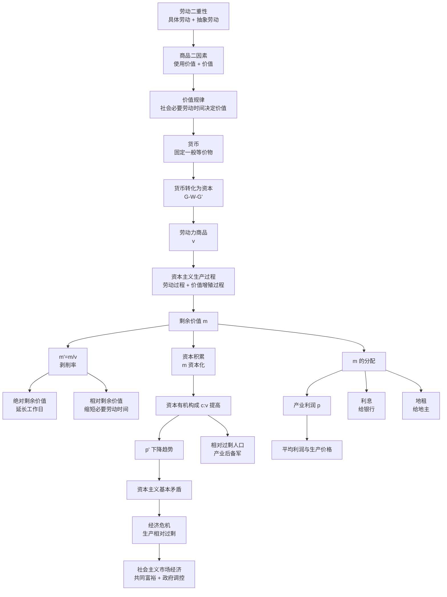

# 15 政治经济学基础 · 章节总结

> 这一页是考前复习和答辩准备用的。先看公式大表，再看关系图，最后做自测题。
> 政治经济学和西方经济学是两套话语体系——不要用"理性人""效用最大化"去套马克思。

---

## 一、一句话总览

学完这一章，你能用**劳动价值论 + 剩余价值论**这套话语，分析工资 vs 利润、机器换人、平台剥削、高房价、经济危机、共同富裕这些现实问题，而不是只会说"供需关系"。

---

## 二、核心概念清单表

| 序号 | 概念 | 一句话 | 对应原 KP |
|---|---|---|---|
| 01 | 商品二因素与劳动二重性 | 使用价值 vs 价值；具体劳动创造使用价值，抽象劳动形成价值 | 01章/KP01、KP02 |
| 02 | 价值规律 | 价值由社会必要劳动时间决定，价格围绕价值波动 | 01章/KP08 |
| 03 | 货币本质与五大职能 | 货币是固定充当一般等价物的商品；五大职能：价值尺度、流通手段、贮藏、支付、世界货币 | 01章/KP05、KP06、KP07 |
| 04 | 剩余价值生产 | 工人创造的新价值 > 工资，多出来的 m 被资本家无偿占有 | 02章/KP04、KP06、KP07 |
| 05 | 不变资本与可变资本 | c 只转移价值，v 才创造 m；m'=m/v 是剥削率 | 02章/KP05 |
| 06 | 资本积累与有机构成 | m 再投资 = 积累；c:v 提高 → p' 下降 + 相对过剩人口 | 02章/KP09、KP10 |
| 07 | 资本循环与周转 | G-W…P…W'-G'；周转越快，年 m 越多 | 03章/KP01、KP02、KP03 |
| 08 | 平均利润与生产价格 | p' 平均化，商品按 k+平均利润卖，不按价值卖 | 03章/KP05 |
| 09 | 利息与地租 | 利息和地租都是 m 的转化形式，被银行家和地主分走 | 03章/KP07、KP08 |
| 10 | 资本主义经济危机 | 生产相对过剩；根源是基本矛盾 | 04章/KP01 |
| 11 | 社会主义市场经济 | 公有制为主体 + 市场起决定作用 + 更好发挥政府作用 + 共同富裕 | 05、06章核心 |

---

## 三、核心公式大表

| 公式 | 是什么 | 一句话 |
|---|---|---|
| $W = c + v + m$ | 商品价值构成 | 不变资本 + 可变资本 + 剩余价值 |
| $m' = m/v$ | 剩余价值率（剥削率） | 工人新创造价值里，资本家拿走多少 |
| $m' = $ 剩余劳动时间/必要劳动时间 | 剥削率的时间表达 | 一天里几小时给自己、几小时白干 |
| $p' = m/(c+v) = m/k$ | 利润率 | 掩盖剥削，把 m 看成全部资本的产物 |
| $M' = m' \times n$ | 年剩余价值率 | 周转越快，年剥削越重 |
| $n = U/u$ | 周转次数 | 一年转几圈 |
| $M = PQ/V$ | 货币流通规律 | 需要多少货币 = 商品价格总额 / 流通速度 |
| $\bar p' = \sum m / \sum(c+v)$ | 平均利润率 | 社会总 m / 社会总资本 |
| 生产价格 $= k + \bar p$ | 自由竞争下商品售价 | 成本价格 + 平均利润 |
| 土地价格 $= $ 年地租 / 年利率 | 地租资本化 | 地租是收入流，除以利率 = 一次性价格 |
| $W-G-W$ | 简单商品流通 | 为买而卖（先卖后买） |
| $G-W-G'$ | 资本流通 | 为卖而买（为增殖） |

---

## 四、概念关系图

---

## 五、十大易错点

1. **不要把"价值"等同于"价格"**——价值是本质（劳动量），价格是现象（货币表现），价格围绕价值波动。
2. **不要说"机器也创造价值"**——机器是 c，只转移价值，不创造新价值。新价值只有工人抽象劳动能创造。
3. **不要把 m' 和 p' 混为一谈**——m' = m/v（剥削率，揭露真相）；p' = m/(c+v)（利润率，掩盖真相）。
4. **不要把"劳动"和"劳动力"混为一谈**——王总买的是劳动力（劳动能力），不是劳动。如果买的是劳动，就没有 m 了。
5. **不要把绝对过剩和相对过剩混为一谈**——资本主义危机是相对过剩（穷人买不起），不是绝对过剩（东西真的太多）。
6. **不要认为资本积累是"节欲"的结果**——马克思批判过，积累是竞争逼的，不是道德选择。
7. **不要认为技术进步必然导致失业**——失业是资本主义生产关系下的表现；社会主义下技术进步可以表现为缩短工时。
8. **不要把货币流通规律 $M=PQ/V$ 直接套现代 M2**——那是金属货币时代的基础公式，当代要考虑信用货币、货币乘数。
9. **不要把共同富裕说成"杀富济贫"**——是全体人民、全面富裕、共建共富、逐步共富，允许合理差距。
10. **不要用西方经济学"理性人"框架套马克思**——马克思不讨论效用最大化，他讨论生产关系和阶级剥削。

---

## 六、论文里怎么用这一章？

这一章在实证论文里扮演三个角色：

### 6.1 理论基础（文献综述部分）

凡是涉及**收入分配、劳动报酬、工资 vs 利润**的论文，都要用劳动价值论和剩余价值论作为理论框架：

- 劳动收入份额 $= v/(v+m)$
- 劳动收入份额下降 = m/v 上升 = 剥削加重

**典型题目**："数字经济发展对我国劳动收入份额的影响"

### 6.2 机制分析（回归系数解释）

凡是涉及**技术进步、自动化、AI**的论文，用资本有机构成解释：

- c:v 提高 → 对低技能劳动需求下降 → 就业极化
- c:v 提高 → p' 下降趋势 → 制造业利润率下降

**典型题目**："人工智能对中国制造业就业结构的影响"

### 6.3 政策建议（结论部分）

凡是涉及**共同富裕、政府与市场、反垄断**的论文，用社会主义市场经济理论：

- 初次分配重效率和公平，再分配重公平，三次分配靠自愿
- 市场起决定性作用 + 更好发挥政府作用
- 反垄断 = 让 p' 平均化，恢复价值规律的作用

**典型题目**："平台经济反垄断的经济学依据与政策选择"

### 本科论文高频选题清单

| 方向 | 典型题目 | 用到的核心概念 |
|---|---|---|
| 劳动收入份额 | 数字经济对劳动收入份额的影响 | 剩余价值、m'、v/(v+m) |
| 平台经济 | 外卖骑手剩余价值榨取研究 | 绝对/相对剩余价值、算法管理 |
| AI 就业 | 人工智能对制造业就业的影响 | 资本有机构成、相对过剩人口 |
| 高房价 | 高房价与土地财政的政经分析 | 级差地租、土地价格=地租/利率 |
| 共同富裕 | 浙江共同富裕示范区路径 | 按劳分配、三次分配、反垄断 |
| 经济危机 | 2008 金融危机的政经分析 | 基本矛盾、支付链条断裂 |
| 反垄断 | 平台垄断对 p' 平均化的阻断 | 平均利润、垄断价格 |
| 双循环 | 扩大内需与生产相对过剩 | 资本主义基本矛盾 |

---

## 七、自测题

**题1**：用服装厂的例子，手算 m'。已知工人日工资 200 元，一天工作 8 小时，每小时创造新价值 50 元。求：① m 是多少？② m' 是多少？③ 必要劳动时间和剩余劳动时间各几小时？

**题2**：王老板奶茶店 c=7400，v=5000，营业额 16500。求：① m 是多少？② m' 是多少？③ p' 是多少？④ 为什么 m' > p'？

**题3**：三个部门 c:v 分别是 8:2、6:4、2:8，资本都是 100，m' 都是 100%。求：① 各部门 p'；② 平均利润率；③ 各部门生产价格。

**题4**：某国一年待售商品 100 亿件，每件 100 元，货币流通速度 5 次。求：① 需要多少货币？② 如果央行发行 2500 亿，物价涨多少？③ 1 元购买力变成多少？

**题5**：奶茶店周转一次 1 个月，面包店周转一次 2 个月，两家 v 都是 5000/月，m'=100%。两家年 m 各是多少？

**题6**：地铁站口铺面年地租 8 万，银行年利率 4%。这个铺面卖多少钱？如果利率降到 2%，地价变成多少？

**题7**：为什么说"价格围绕价值波动不是对价值规律的否定，而是它的实现形式"？

**题8**：为什么外卖骑手算法算的是"时间"而不是"动作"？用劳动二重性解释。

**题9**：资本主义经济危机的实质和根源是什么？为什么说危机是"强制恢复平衡"？

**题10**：用"市场决定性作用 + 更好发挥政府作用"分析为什么要反垄断。

---

## 八、自测题答案（先自己做再看）

点开看答案

**题1**：
- 一天新创造价值 = 8 × 50 = 400 元；
- m = 400 - 200 = 200 元；
- m' = 200/200 = 100%；
- 必要劳动时间 = 200/50 = 4 小时；剩余劳动时间 = 8 - 4 = 4 小时。

**题2**：
- m = 16500 - 7400 - 5000 = 4100；
- m' = 4100/5000 = 82%；
- p' = 4100/(7400+5000) = 33.1%；
- m' > p' 因为 m' 分母只有 v（活钱），p' 分母是 c+v（死钱+活钱）。p' 把不创造 m 的 c 也算进分母，掩盖了剥削。

**题3**：
- 各部门 m：20、40、80；p'：20%、40%、80%；
- 平均 p' = (20+40+80)/300 = 46.7%；
- 每部门平均利润 = 46.7；生产价格 = 100 + 46.7 = 146.7。

**题4**：
- PQ = 100 × 100 = 10000 亿；
- M = 10000/5 = 2000 亿；
- 实际发 2500 亿，超发 25%；物价从 100 涨到 125，涨 25%；
- 1 元购买力 = (1/125)/(1/100) = 0.8，贬值 20%。

**题5**：
- 奶茶店 n=12，年 m = 5000 × 100% × 12 = 60000；
- 面包店 n=6，年 m = 5000 × 100% × 6 = 30000。

**题6**：
- 地价 = 8/0.04 = 200 万；
- 利率降到 2%：地价 = 8/0.02 = 400 万（翻倍）。
- 这就是为什么降息周期房价暴涨。

**题7**：因为私有制下没有中央计划者，社会总劳动在各部门的分配只能靠价格波动这个"看不见的指挥棒"来调节。波动是手段，等价交换是长期趋势。

**题8**：算法把取餐、送餐、爬楼全抽象成"几分钟一单"——这就是抽象劳动在数字时代的体现。骑手的具体动作被算法抹平，只剩下时间耗费。平台按抽象劳动时间买骑手的劳动力。

**题9**：实质是生产相对过剩（不是绝对过剩）；根源是资本主义基本矛盾（生产社会化 vs 生产资料私人占有）。危机中企业倒闭、商品销毁、库存出清，用破坏性方式恢复再生产比例——但不解决矛盾，下一次更猛烈。

**题10**：市场起决定性作用 = 让价值规律充分发挥作用，p' 平均化；但垄断阻断了 p' 平均化，让垄断资本长期拿超额利润。政府反垄断 = 维护竞争，补市场失灵，让价值规律正常起作用。

---

## 九、本章方法答辩速查

1. **问：你说的"剥削"是什么意思？有数据吗？** 答：剥削率 m' = m/v。实证里常用劳动收入份额 v/(v+m) 作为代理变量。劳动收入份额下降，意味着 m/v 上升，即 m' 上升。这是有统计数据支撑的（国家统计局资金流量表）。

2. **问：马克思主义和西方经济学是什么关系？** 答：两套话语体系。西方经济学从"理性人 + 边际产出"出发，把工资和利润看成各自的要素报酬；马克思主义从"生产关系 + 劳动价值论"出发，揭示利润是工人创造的 m。两者在实证方法上可以结合（都用计量回归），但理论框架不同。

3. **问：你写"数字经济提高了剥削率"，导师说这是意识形态不是学术。怎么回应？** 答：把概念操作化——剥削率 m' 可以用劳动收入份额的反向变化来衡量；算法管理对劳动强度的影响，可以用配送时间压缩、在线时长、单均收入等可观测指标来衡量。不做规范判断，只做实证描述。

4. **问：社会主义市场经济和资本主义市场经济有什么本质区别？** 答：所有制基础不同（公有制为主体 vs 私有制）；分配目的不同（共同富裕 vs 资本增殖）；政府作用不同（更好发挥政府作用 vs 守夜人）；危机形态不同（生产相对过剩 vs 我们是结构调整）。

---

⬅️ 上一篇：[[../14_宏观经济学基础/00_章节总结|14 宏观经济学基础·章节总结]] ｜ 📑 [[README|返回教程目录]] ｜ 下一篇：[[../16_拓展阅读/00_章节总结|16 拓展阅读 →]] ➡️

---

## 📖 配套教材笔记

- [[../../教材笔记/07_政治经济学/01_商品与货币/00_章节总结|原书·第1章 商品与货币]]
- [[../../教材笔记/07_政治经济学/02_资本主义经济制度与生产/00_章节总结|原书·第2章 资本主义经济制度与生产]]
- [[../../教材笔记/07_政治经济学/03_资本流通与剩余价值分配/00_章节总结|原书·第3章 资本流通与剩余价值分配]]
- [[../../教材笔记/07_政治经济学/04_经济危机与历史趋势/00_章节总结|原书·第4章 经济危机与历史趋势]]
- [[../../教材笔记/07_政治经济学/05_社会主义经济制度/00_章节总结|原书·第5章 社会主义经济制度]]
- [[../../教材笔记/07_政治经济学/06_社会主义市场经济与发展/00_章节总结|原书·第6章 社会主义市场经济与发展]]
