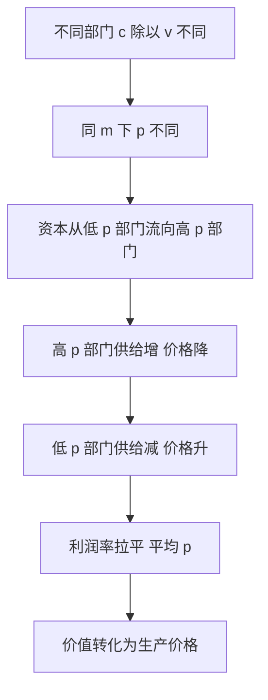

# 08 平均利润与生产价格是什么？（小白版）

<a href="../../exam.html" target="_blank" style="display:inline-block;padding:6px 16px;background:#2563eb;color:#fff;border-radius:6px;text-decoration:none;font-size:14px;">📝 开始做题</a>

## 一、为什么要学这个？

前面我们一直说 m 是工人创造的。但现实中你听到的不是"剩余价值"，而是"利润"——王总赚了 4100 元，他会说"我投了 12400 元，回报率 33%"。

这一篇讲清楚两件事：

1. **利润就是 m，只不过换了个马甲**——从"v 的产物"改口成"c+v 的产物"，剥削关系就被掩盖了。
2. **不同行业利润为什么会平均化？**——重工业 c:v 高、p' 低；轻纺业 c:v 低、p' 高。资本家往高利润行业跑，最后竞争让大家都拿平均利润。

你以后写论文做这些题目都会用到：

- "不同行业利润率差异研究"
- "平台经济利润来源分析"
- "反垄断为什么重要"
- "房地产暴利的政经解释"

---

## 二、是什么？

### 生活比喻：三个行业的老板互相跳槽

假设三个部门，m' 都 = 100%：

| 部门 | c | v | m | 资本总额 | p'（利润率） |
|---|---|---|---|---|---|
| 重工业 | 80 | 20 | 20 | 100 | 20% |
| 轻工业 | 60 | 40 | 40 | 100 | 40% |
| 食品业 | 20 | 80 | 80 | 100 | 80% |

**问题**：食品业 p' = 80%，重工业 p' = 20%。资本家会怎么想？

"我傻啊？在重工业赚 20%，去食品业赚 80%？"

于是：

- 从重工业撤资 → 重工业供给减少 → 价格回升 → p' 上升；
- 冲进食品业 → 食品业供给暴增 → 价格下跌 → p' 下降；
- 直到三个部门 p' 差不多，资本不再流动。

### 严格定义

| 概念 | 公式 | 大白话 |
|---|---|---|
| 成本价格 k | $k = c + v$ | 生产商品耗费的全部资本 |
| 利润 p | $p = m$ | m 被看成全部预付资本的产物（换了个马甲） |
| 利润率 p' | $p' = m/(c+v) = m/k$ | 每投 100 元赚多少 |
| 平均利润率 $\bar p'$ | $\bar p' = \sum m / \sum(c+v)$ | 全社会剩余价值总量 / 社会总资本 |
| 平均利润 $\bar p$ | $\bar p = C \times \bar p'$ | 每笔资本按平均 p' 分的利润 |
| 生产价格 | $= k + \bar p = (c+v) + \bar p$ | 自由竞争下商品的实际售价 |

---

## 三、这套道理是怎么推出来的？（手把手）

**第一步：m 怎么变成 p？**

工人新创造价值 = v + m。但资本家眼里：

- 他花了 c（机器原料）+ v（工资）= k（成本价格）；
- 卖商品得到 k + m；
- 他觉得 m 是 k 生出来的——因为他不知道、也不愿意承认 m 只是 v 生的。

所以 $p' = m/(c+v)$ 这个公式本身就掩盖了 m 的真正来源。

**第二步：算平均利润率。**

三个部门总 m = 20 + 40 + 80 = 140。
三个部门总资本 = 100 + 100 + 100 = 300。

$$\bar p' = \frac{140}{300} \approx 46.7\%$$

每个部门 100 元资本都拿平均利润 46.7 元。

**第三步：生产价格怎么形成？**

| 部门 | k = c+v | 价值 = c+v+m | 平均利润 | 生产价格 = k + p̄ |
|---|---|---|---|---|
| 重工业 | 100 | 120 | 46.7 | **146.7** |
| 轻工业 | 100 | 140 | 46.7 | **146.7** |
| 食品业 | 100 | 180 | 46.7 | **146.7** |

**关键洞察**：

- 重工业：生产价格 146.7 > 价值 120（多卖 26.7）；
- 食品业：生产价格 146.7 < 价值 180（少卖 33.3）；
- 全社会总和：生产价格总和 = 价值总和（都 = 440）。

**所以生产价格不是否定价值规律，而是价值规律在资本主义自由竞争阶段的转化形式。**

**第四步：谁在拿谁的 m？**

- 重工业工人创造的 m 少（v 小），但按生产价格卖，多拿了别人的 m；
- 食品业工人创造的 m 多（v 大），但按生产价格卖，自己创造的 m 被重工业资本家分走一块。

**整个资产阶级共同剥削整个工人阶级，然后按资本大小瓜分 m。**

---

## 四、一个完整的数字例子（手算）

**题目**：社会有三个部门，资本都是 100，m' 都是 100%，c:v 分别是 8:2、6:4、2:8。

① 各部门 p' 是多少？
② 平均利润率是多少？
③ 各部门生产价格是多少？
④ 哪个部门多拿了 m？哪个少拿了？

**第一步：各部门价值构成。**

- 重工业：c=80, v=20, m=20, 价值 = 120；
- 轻工业：c=60, v=40, m=40, 价值 = 140；
- 食品业：c=20, v=80, m=80, 价值 = 180。

**第二步：各部门 p'。**

- 重工业：p' = 20/100 = 20%；
- 轻工业：p' = 40/100 = 40%；
- 食品业：p' = 80/100 = 80%。

**第三步：平均利润率。**

$$\bar p' = \frac{20+40+80}{100+100+100} = \frac{140}{300} \approx 46.7\%$$

**第四步：各部门平均利润和生产价格。**

- 每部门平均利润 = 100 × 46.7% = 46.7；
- 生产价格 = k + p̄ = 100 + 46.7 = 146.7。

**第五步：对比价值和生产价格。**

| 部门 | 价值 | 生产价格 | 差额 |
|---|---|---|---|
| 重工业 | 120 | 146.7 | +26.7（多卖） |
| 轻工业 | 140 | 146.7 | +6.7（多卖） |
| 食品业 | 180 | 146.7 | -33.3（少卖） |

**结论**：重工业和轻工业资本家，从食品业工人那里分走了一部分 m。这就是**剩余价值在不同部门资本家之间的重新分配**。

---

## 五、什么时候能用？

- 分析**自由竞争下**的行业利润形成。
- 分析**资本在部门间的流动**。
- 分析**生产价格和价值的关系**（价值规律的转化形式）。

---

## 六、什么时候不能用？（易错点）

1. **平均利润理论假设资本和劳动力自由流动。** 现实中垄断、管制、工会、国界限制流动，p' 不会完全平均。
2. **当代数字平台是新的垄断形态**，p' 长期高于平均水平，因为网络效应锁定用户。
3. **生产价格是自由竞争资本主义的范畴。** 到了垄断阶段，出现垄断价格（长期高于生产价格）。
4. **现实中 p' 没有完全平均化**，因为有行业壁垒、国际资本流动限制、风险差异。但**趋势**是平均化。

---

## 七、容易和什么搞混？

| 容易混 | 区别 |
|---|---|
| 价值 vs 生产价格 | 价值 = c+v+m；生产价格 = c+v+平均利润。前者是本质，后者是转化形式 |
| 利润 vs 剩余价值 | p = m，但 p 是 m 的转化形式（被看成全部资本的产物） |
| 利润率 vs 剩余价值率 | p' = m/(c+v)；m' = m/v。p' 总是小于 m'，且 c:v 越高 p' 越低 |
| 生产价格 vs 垄断价格 | 生产价格 = 自由竞争下的 k+p̄；垄断价格 = 垄断资本人为抬高的价格 |
| 平均利润 vs 超额利润 | 平均 = 全社会 p' 平均化；超额 = 个别资本家先提高生产率多得的临时 m |

---

## 八、在论文里怎么用？

**场景 1：行业利润差异论文。**
"中国制造业 vs 互联网行业利润率差异研究"——用平均利润理论分析：
- 自由竞争下 p' 有平均化趋势；
- 但现实中制造业 p' 长期低于互联网，因为互联网垄断阻断了平均化（网络效应、平台锁定）；
- 结论：要反垄断，让 p' 回归平均。

**场景 2：平台经济利润来源论文。**
"平台企业利润来源的政治经济学分析"——平台利润不是"技术租金"那么简单：
- 它是 m 在平台资本家、商家、骑手之间的重新分配；
- 平台凭借垄断地位，拿到了超过平均利润的垄断利润。

**场景 3：房地产暴利论文。**
"中国房地产高利润率的原因"——房地产 p' 长期高，因为土地垄断 + 金融支持，p' 平均化被阻断。这就是为什么要反垄断、为什么要房产税。

**场景 4：反垄断政策论文。**
"平台反垄断的经济学依据"——垄断阻止了 p' 平均化，让垄断资本长期拿超额利润，损害消费者和中小商家。

**常见踩坑：**

- ❌ 认为"利润是企业家才能的报酬"——p = m，本质是工人创造的，被资本家集体瓜分。
- ❌ 认为生产价格否定了劳动价值论——没有，生产价格总和 = 价值总和，它只是价值规律的转化形式。
- ❌ 用现实 p' 差异直接否定平均利润理论——现实有壁垒，但趋势是平均化。

**📊 对应统计方法**：

- [[../05_内生性与面板/06_固定效应FE|面板FE]] —— 用行业面板估计利润率是否趋于平均化，控制行业 FE 后看长期收敛趋势。
- [[../03_相关与回归/02_什么是回归|回归分析]] —— 回归各行业利润率对资本有机构成的关系，检验"有机构成高则利润率低"的命题。

---

## 九、现实意义

- **为什么资本追逐高利润行业？** p' 平均化趋势。哪里利润高，资本就往哪里跑。
- **为什么要反垄断？** 垄断阻止 p' 平均化，让垄断资本长期拿超额利润。
- **中国的"合理利润率"政策**：对关系国计民生的行业（电力、水务）限制利润率，不让它们按平均利润榨取消费者。
- **理解房地产暴利时代**：房地产 p' 长期高，因为土地垄断 + 金融支持，p' 平均化被阻断。
- **为什么古典派李嘉图解决不了"价值规律和平均利润率矛盾"？** 他不懂价值转化为生产价格，最终放弃了劳动价值论。马克思在《资本论》第三卷解决了这个"巨大的历史难题"。

---

## 十、速记卡

> **利润 p = 剩余价值 m，只是换了个马甲。**
> **利润率 p' = m/(c+v)，掩盖了剥削。**
> **不同部门 c:v 不同 → p' 不同 → 资本流动 → p' 平均化。**
> **商品按生产价格 = k + 平均利润 卖，不按价值卖。**
> **整个资产阶级共同剥削工人阶级，然后按资本大小瓜分 m。**

---

⬅️ 上一篇：[[07_资本循环与周转|07 资本循环与周转]] ｜ 📑 [[00_章节总结|返回目录]] ｜ 下一篇：[[09_利息与地租|09 利息与地租]] ➡️

---

## 附：理论推导与数学推导（深度补充）

### 一、理论推导（利润怎么转化为平均利润）

**出发点**：不同部门资本有机构成不同，即使剩余价值率 m' 相同，利润率也不同。

**推导过程**：
- 第一步：部门 A（食品）c/v = 7/3，部门 B（机械）c/v = 9/1，m' = 100%。
- 第二步：部门 A p'_A = 3/(7+3) = 30%；部门 B p'_B = 1/(9+1) = 10%。
- 第三步：部门 A 利润率高，资本从 B 流入 A。
- 第四步：A 部门供给增加 → 价格下降 → 利润下降；B 部门供给减少 → 价格上升 → 利润上升。
- 第五步：资本流动直到各部门利润率拉平 → 平均利润率 $\bar{p}'$。

### 二、数学推导（平均利润率与生产价格）

设社会总资本 $C = \sum c_i$，$V = \sum v_i$，总剩余价值 $M = \sum m_i$。
**平均利润率**：
$$\bar{p}' = \frac{\sum m_i}{\sum(c_i + v_i)} = \frac{M}{C+V}$$

**平均利润**：每个资本按其资本量获得 $\bar{p}_i = (c_i + v_i)\bar{p}'$。

**生产价格** = 成本价格 + 平均利润 = $(c_i + v_i) + (c_i + v_i)\bar{p}' = (c_i + v_i)(1 + \bar{p}')$。

**数字例子**：
- 社会总 M = 40，总 C+V = 200 → $\bar{p}' = 20\%$。
- 部门 A 资本 100（c=70, v=30）：平均利润 = 100×20% = 20。生产价格 = 100+20 = 120。
- 部门 B 资本 100（c=90, v=10）：平均利润 = 100×20% = 20。生产价格 = 100+20 = 120。
- 注意：部门 A 原本 m=30，现在只拿 20；部门 B 原本 m=10，现在拿 20——利润在部门间重新分配。

### 三、规律

**生产价格是价值的转化形式**：
- 全社会生产价格总额 = 全社会价值总额。
- 全社会平均利润总额 = 全社会剩余价值总额。
- 生产价格随价值变动而变动。

**mermaid 因果图**：

### 四、生活实例

**奶茶店 vs 芯片厂**：奶茶店 c/v 低（主要靠店员），p' 高；芯片厂 c/v 高（机器贵），p' 低。资本从芯片厂流向奶茶店——奶茶店多了，竞争加剧，价格下降；芯片厂少了，芯片价格上升。最后两者利润率拉平——这就是平均利润规律。

---

## 📖 配套教材笔记

- [[../../教材笔记/07_政治经济学/03_资本流通与剩余价值分配/知识点/KP05_平均利润与生产价格|原KP·平均利润与生产价格]]
