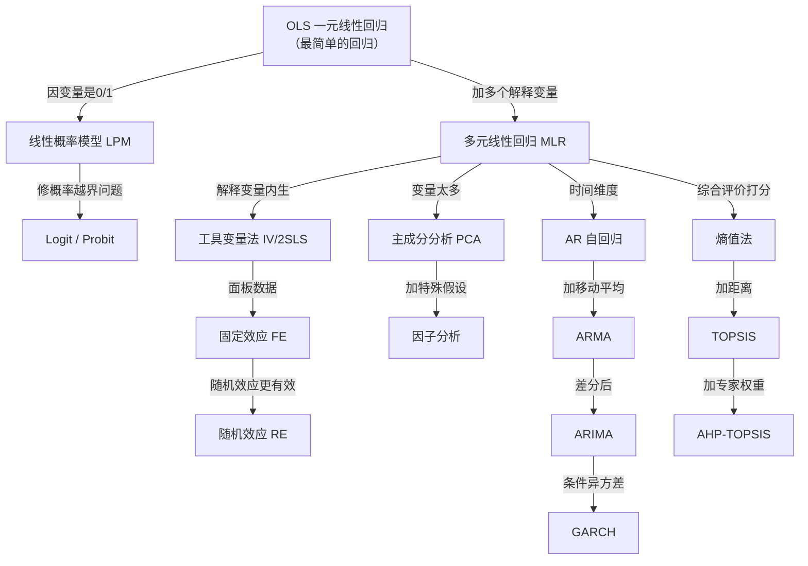

# 经济统计学：论文从 0 基础到精通

> 一本给"从没写过论文、从没学过数学和统计学"的人的**完全自包含**教程。
> 打开这一个文件夹，不看别的任何资料，你就能从"什么是变量"一路学到"写出一篇规范的本科毕业论文"。

---

## 这本教程是给谁的？

假设你是这样的人：

- 高考数学刚及格，大学高数挂过或差点挂；
- 不知道"回归"是什么，只听过"[[01_相关系数|相关系数]]"这个词；
- 从没写过任何正式论文，连摘要都没写过；
- 但你必须在本学期完成一篇经济统计学方向的毕业论文；
- 你害怕公式，看到希腊字母就头皮发麻。

**这本教程就是为你写的。**

我们不会假设你已经会任何东西。每一个符号、每一步推导、每一行代码，都会从"这一步是因为……所以……"开始讲。

**禁止出现的词**："显然""易证""由定理可知""不难看出""众所周知"。
凡是用了这些词的地方，就是作者偷懒——本教程不允许偷懒。

---

## 怎么用这本教程？

### 第一条路线：你时间充裕（一学期以上）

按文件夹编号 **00 → 12** 顺序读。这是给零基础的人设计的完整路径。

```
00 学前准备     → 先搞清楚"我到底在学什么、为什么要学"
01 基础数学     → 只补后面真正用得到的数学，不教没用的
02 描述统计     → 数据长什么样，怎么画出来看
03 相关与回归   → 全教程的心脏：OLS 是怎么来的
04 回归三大问题 → 真实数据不完美时怎么办
05 内生性与面板 → 怎么说出"X 真的导致了 Y"这句话
06 受限因变量   → 当答案只能是"是/否""几档"时
07 综合评价方法 → 给城市/公司/省份打分排名的一整套武器
08 降维与分类   → 变量太多时怎么压成少数几个主成分
09 时间序列     → 预测未来（GDP、股价、销量）
10 论文写作全流程 → 从选题到答辩的完整流水线
11 方法选择决策 → 拿到一个题目，到底该用哪个模型
12 毕业论文实战 → 重庆财经学院格式、三线表、参考文献、答辩
```

### 第二条路线：你马上要交论文了（2 周内）

直接跳到：

1. [`11_方法选择决策/`](11_方法选择决策/README.md) —— 对着决策树找到你的方法
2. [`12_毕业论文实战/`](12_毕业论文实战/README.md) —— 按格式模板套
3. 遇到不懂的概念，再回 [`03_相关与回归/`](03_相关与回归/README.md) 查

### 第三条路线：你在复习备考

每个文件夹里都有一个 `00_章节总结.md`，先看它的"核心公式清单"和"自测题"，不会的再回去读对应知识点。

---

## 每个知识点长什么样？

本教程的每一个知识点文件，都按下面这 10 段写，一个都不能少：

1. **为什么要学这个**——生活里的真实痛点，不学会会怎样；
2. **是什么**——先给一个生活化的比喻，再给严格定义；
3. **公式怎么来的**——从直觉一步步推，不跳步，每步说"这一步是因为……"；
4. **每个符号是什么**——β₁ 是什么、X 是什么、ε 是什么，一个都不漏；
5. **一个完整的数字例子**——从原始数据一步步手算到结果，中间结果全写出来；
6. **什么时候能用**——数据要满足什么条件、前提假设是什么；
7. **什么时候不能用 / 易错点**——违反假设会发生什么、导师会怎么骂；
8. **Stata / R 代码**——每行注释为什么这么写、输出怎么读；
9. **和别的方法对比**——为什么用这个不用那个；
10. **速记卡**——一句话总结，考前扫一眼。

---

## 文件夹总览

| 文件夹 | 学完你会 |
|--------|----------|
| [00_学前准备](00_学前准备/README.md) | 知道经济统计学是干嘛的、论文长什么样、数学要补到哪 |
| [01_基础数学](01_基础数学/README.md) | 看得懂函数、导数、矩阵、概率，不害怕希腊字母 |
| [02_描述统计](02_描述统计/README.md) | 拿到一份数据，会算均值方差、会画图、会讲故事 |
| [03_相关与回归](03_相关与回归/README.md) | 手推 [[04_OLS截距和拟合值|OLS]]，看懂 t 检验、F 检验、R² |
| [04_回归三大问题](04_回归三大问题/README.md) | 诊断[[02_异方差|异方差]]/[[03_自相关|自相关]]/[[04_多重共线性|多重共线性]]并会修 |
| [05_内生性与面板](05_内生性与面板/README.md) | 用[[03_工具变量IV|工具变量]]、[[06_固定效应FE|固定效应]]说出因果 |
| [06_受限因变量](06_受限因变量/README.md) | 做 Logit/Probit，解释几率比 |
| [07_综合评价方法](07_综合评价方法/README.md) | [[06_熵值法-TOPSIS组合|熵值法]]/AHP/TOPSIS/模糊综合/灰色关联全打通 |
| [08_降维与分类](08_降维与分类/README.md) | PCA、因子分析、聚类、判别 |
| [09_时间序列](09_时间序列/README.md) | 平稳性、ARIMA、GARCH、协整 |
| [10_论文写作全流程](10_论文写作全流程/README.md) | 选题库→文献综述→数据获取→实证写作→结果解读→稳健性→结论摘要→技术路线图 |
| [11_方法选择决策](11_方法选择决策/README.md) | 决策树选模型、15 种组合套路、常见坑、Stata/R 速查、SPSS 指引 |
| [12_毕业论文实战](12_毕业论文实战/README.md) | 重财格式、三线表、GB/T 7714、引言、答辩 50 问、查重、时间线、开题报告、完整范文、提交 Checklist |

---

## 方法关系系谱图（先有个印象，后面会懂）

> 统计学里很多方法，其实是"同一个东西在不同假设下的推广"。
> 下面这张图告诉你谁是谁的特例——学完前面的再回来看，会豁然开朗。



**怎么读这张图**：箭头从"特例"指向"推广"。
比如 OLS 是 IV 的特例（当没有内生性时，IV 就退化成 OLS）；AR 是 ARMA 的特例（当移动平均项 MA(θ)=0 时）。
**当你学到后面觉得"这怎么和前面那么像"的时候，就是因为它们本来就是亲戚。**

---

## 📚 配套教材笔记（🩵 统计学原理 · 韩兆洲第7版）

本教程讲"怎么用方法写论文"；配套的教材笔记讲"每个概念本身是怎么来的"。两者互补：

- **入口**：[`教材笔记/05_统计学原理/`](../教材笔记/05_统计学原理/README.md) — 11 章 111 个 KP，每章一张竖版 SVG 思维导图
- **对应关系**：
  - Ch1 绪论（总体/样本/标志/指标）↔ 本教程 [`00_学前准备/`](00_学前准备/README.md) 与 [`01_基础数学/`](01_基础数学/README.md)
  - Ch2-3 数据采集与整理 ↔ 本教程 [`02_描述统计/`](02_描述统计/README.md)
  - Ch4-5 总量/相对/平均/变异指标 ↔ 本教程 [`02_描述统计/`](02_描述统计/README.md)
  - Ch6-7 抽样与假设检验 ↔ 本教程 [`01_基础数学/`](01_基础数学/README.md) 概率统计部分 + [`03_相关与回归/`](03_相关与回归/README.md)
  - Ch8 相关与回归 ↔ 本教程 [`03_相关与回归/`](03_相关与回归/README.md) 与 [`04_回归三大问题/`](04_回归三大问题/README.md)
  - Ch9 传统时间序列 ↔ 本教程 [`09_时间序列/`](09_时间序列/README.md)（ARIMA/GARCH 现代时序）
  - Ch10 统计指数（拉氏/派氏/基期/报告期）↔ 本教程 [`09_时间序列/09_基期报告期与指数方法选择.md`](09_时间序列/09_基期报告期与指数方法选择.md)
  - Ch11 综合评价法 ↔ 本教程 [`07_综合评价方法/`](07_综合评价方法/README.md)（含 [`10_距离方法选择指南.md`](07_综合评价方法/10_距离方法选择指南.md)：欧式/马氏/曼哈顿/切比雪夫/兰氏对比）
  - Ch11 统计报告写作 ↔ 本教程 [`10_论文写作全流程/`](10_论文写作全流程/README.md)

如果你看本教程某个公式觉得"它凭什么长这样"，就回教材笔记对应 KP 看推导直觉。

---

## 排版约定（本教程内部统一）

- 行内公式：`$y = \beta_0 + \beta_1 x$`
- 独立公式：`$$ ... $$`，单独一行
- 图表：所有 mermaid 图都用 `graph TD`（从上到下竖版），节点文字用 `["中文"]` 包起来
- 双向链接：用 Obsidian 风格 `文件名` 互链
- 代码：Stata 用 ```stata，R 用 ```r，Python 用 ```python，**每行都有注释**
- 数字例子：全部用 Python 真实算过，结果可复现
- 表格：三线表（顶线、表头线、底线，无竖线）

---

## 最后一句话

**统计不吓人，它就是"用数据讲故事"的一套工具。**

你不需要成为数学家，你只需要：
1. 知道什么时候该用哪个工具（11 章会教你）；
2. 能读懂工具吐出来的结果（每章都会教）；
3. 知道什么时候工具会骗你（每章的"易错点"会教你）。

从 [`00_学前准备/`](00_学前准备/README.md) 开始吧。
