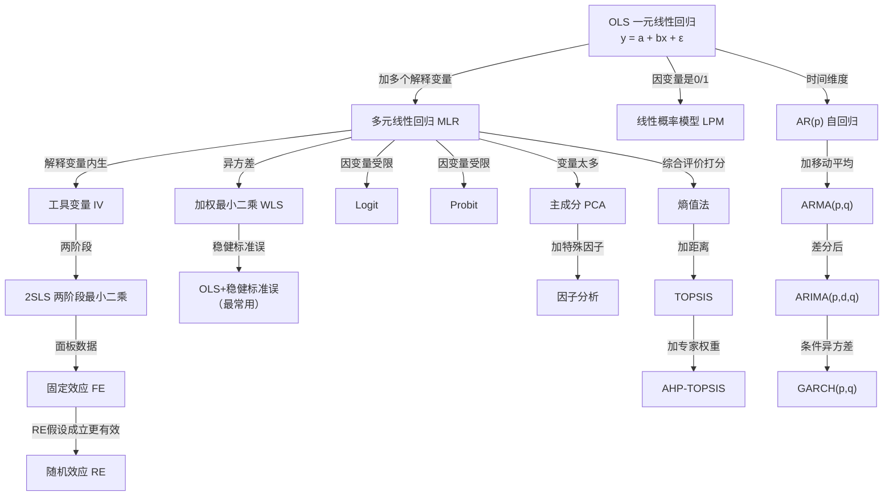
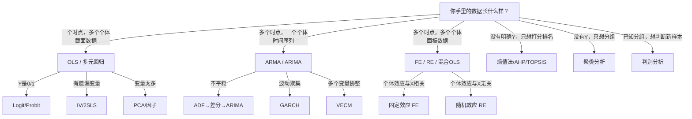
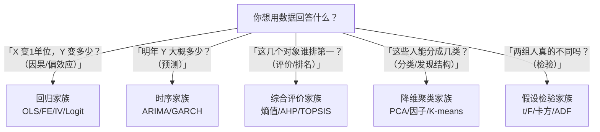
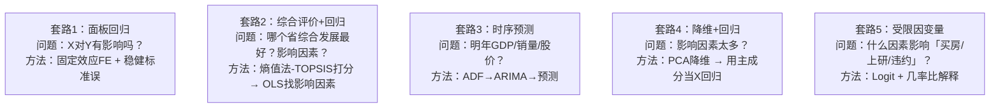

# 方法关系系谱图：谁是谁的特例？

<a href="../../exam.html" target="_blank" style="display:inline-block;padding:6px 16px;background:#2563eb;color:#fff;border-radius:6px;text-decoration:none;font-size:14px;">📝 开始做题</a>

> 统计学里很多方法，看起来是新方法，其实只是"老方法 + 一个新假设"。
> 搞清楚这张图，你就再也不会被"十几个模型"吓住——它们都是一个大家族的亲戚。

---

## 一、总图（从 OLS 出发的大树）

---

## 二、特例关系对照表（背下来论文就不会被问住）

| 当这个条件成立 | 大方法就退化成 | 特例 |
|---------------|---------------|------|
| 没有内生性（Cov(X,ε)=0） | 2SLS → | **OLS** |
| 移动平均项 θ=0 | ARMA → | **AR** |
| 差分阶数 d=0（序列已平稳） | ARIMA → | **ARMA** |
| 没有条件异方差 | GARCH → | **ARMA** |
| 随机效应假设成立 | FE 不如 RE 有效 | **RE** |
| 因子分析特殊因子载荷=0 | 因子分析 → | **PCA** |
| 因变量在 (0,1) 内取值、不溢出 | Logit 没必要 | **LPM 甚至 OLS** |
| 权重全相等（不加权） | WLS → | **OLS** |
| 只有一个指标 | TOPSIS → | **直接排序** |
| 专家权重全相等 | AHP-TOPSIS → | **熵值法-TOPSIS** |

---

## 三、按"数据类型"分家谱

---

## 四、按"你想干嘛"分家谱

---

## 五、最常见的"亲戚"误会

### 误会1：PCA 和回归是一回事？
**不是。**
- 回归：你有明确的 Y，找 X 怎么解释 Y；
- PCA：你没有 Y，只是 X 太多，找几个方向把 X 的信息压缩。
**关系**：PCA 是回归在"没有 Y"时的姐妹方法。

### 误会2：聚类和判别是一回事？
**不是。**
- 聚类：你**不知道**分几类，让数据自己分；
- 判别：你**已经知道**分好类了，找个分界线来判断新样本。
**关系**：聚类在前（探索），判别在后（验证/预测）。

### 误会3：相关分析和回归是一回事？
**相关**：对称的，X 和 Y 谁因谁因不分；只给一个数 r。
**回归**：不对称的，明确 Y 是因变量 X 是自变量；给一条直线。
**关系**：一元回归里 $r = \sqrt{R^2}$，但多元回归没这个关系。

### 误会4：AHP 和熵值法都是"权重方法"，有啥区别？
- AHP：**主观**权重——专家拍脑袋两两比较；
- 熵值法：**客观**权重——数据自己说话（差异大的指标权重大）。
**关系**：实际论文常组合用 AHP-熵值法，主客观结合。

### 误会5：ARIMA 和回归都是"用过去预测未来"，为啥不都用回归？
- 回归要求 X 和 Y 是不同变量；
- 时序里你**只有 Y 自己**（比如 GDP），没有别的 X，所以用 Y 的滞后项当 X，这就是 AR。
**关系**：AR 就是"用 Y 的滞后项当 X 的回归"。

---

## 六、论文里的"方法组合"套路（本科论文最常用的5种）

---

## 速记

> **OLS 是所有回归的根。**
> 加解释变量 → 多元；因变量 0/1 → Logit；X 内生 → IV/2SLS；面板 → FE/RE；时间 → ARIMA；变量太多 → PCA；要打分 → 熵值/TOPSIS。
> 学新方法时先问一句："它是哪个老方法加了什么假设？"——90% 的答案你已经会了。
